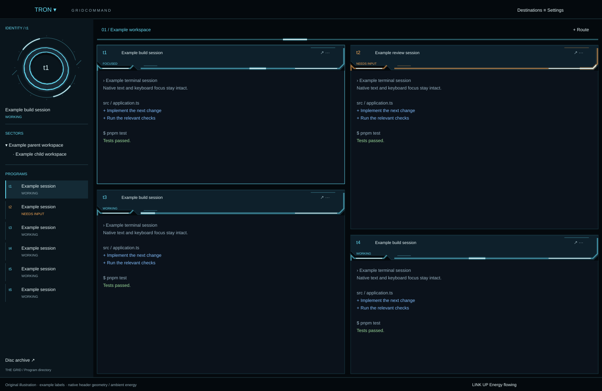
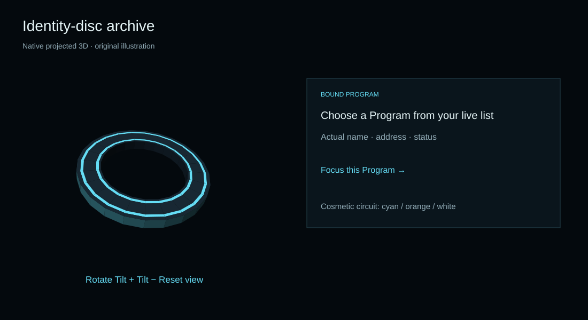
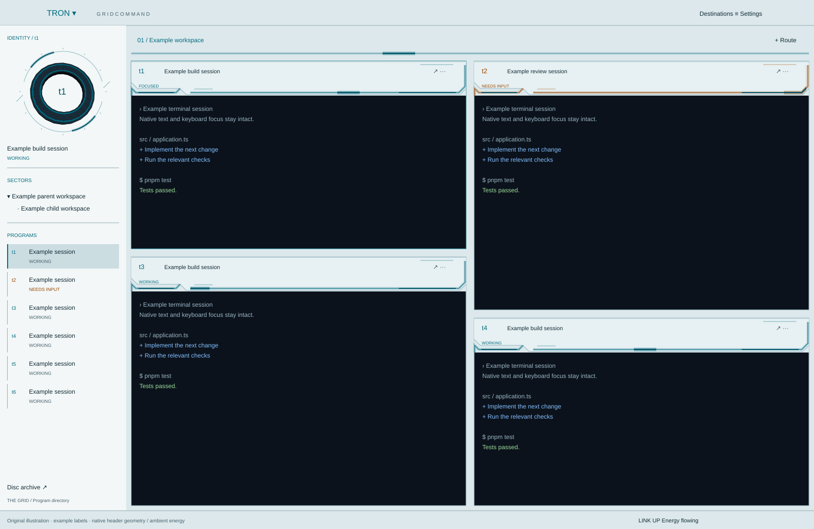

# TRON / Grid Command



**A luminous Grid around your real work.** Native Herdr chrome inspired by *TRON: Legacy*: dark glass console housings, identity discs and breathing light seams. A pale technical appearance keeps the same hierarchy around readable dark terminals.

The images here are **original illustrations**, not screenshots of a live session. They use example labels and contain no terminal conversations. The original release was exercised in Herdr on macOS. **The architectural/energy redesign is installed and was inspected in dark/light at 3840×2130, with native motion controls, inline parent/child navigation and a 110% UI-scale check.** Narrower windows, arbitrary gutter routing and performance acceptance remain open. See [validation](docs/VALIDATION.md) for revision-specific coverage and [design notes](docs/DESIGN.md) for the researched direction and host limits.

| Everyday work | Between operations |
| --- | --- |
| Real sectors, routes and Program status | Two original playable puzzle games, three stages each |
| Explicit pane controls and context targets | A rotatable, lit 3D identity disc |
| Native layout picker and light/dark chrome | ENCOM archive, Bit and earned discoveries |
| Local LINK and hardware-aware battery samples | Reduced motion and resettable local progress |

## Enter the Grid

Requires Herdr with the native `PathBuilder` / `window.paint_path` APIs, Node 24 and pnpm. Development tasks use mise. There are no third-party JavaScript dependencies or bundled fonts.

```sh
daft clone https://github.com/avihut/herdr-tron --layout contained
cd herdr-tron/main
mise trust
mise run test
mise run check
mise run install
```

Select **TRON** in your current layout's picker or run:

```sh
herdr-app do layout.switch --name tron
```

TRON's own **TRON ▾** picker switches back. The installer never activates the layout or changes settings, keys, view state or appearance. Existing TRON paths are refused unless you explicitly update:

```sh
mise run update
```

The installer stages the complete package outside watched `mods`, validates all imports and native roles, installs a `place:none` manifest before its entry point, swaps the complete mod folder, and writes the layout last. Updates preserve unowned files and keep backups under `backups/tron/`. On failed rollback, recovery folders are retained and reported. Do not edit installed copies: edit this repository and update from here.

For a shared live window, coordinate an exclusive QA slot and use the host's QA lock **before** installation or switching. The portable [layout guide](docs/LAYOUT_GUIDE.md) describes the workflow. An available lock never grants extra filesystem or socket permission.

## The working surface

The terminal occupies the main region. A 248px resizable sidebar carries a prominent identity-disc dock, sectors and Programs; a 50px title bar contains navigation and the native layout picker. The focused Program's real address sits inside the projected disc, and the dock opens its archive. The dock contracts on short windows so the Program list remains usable.

A 52px route strip carries the shared visual power bus. Each pane has a 68px measured console housing, clipped glass edges and white-cored light seams. Sixteen-pixel gaps give the consoles breathing room. Borders keep the same width when focus changes, avoiding terminal reflow. Geometry uses logical pixels: resizing changes straight spans, never the proportions of corners.

**Energy flows and breathes.** Native loops send a highlight back and forth along each header rail and the tab bus while the surrounding light slowly swells. This is ambient atmosphere, not message-delivery telemetry. `Energy still` stops the motion. The [animated SVG illustration](previews/energy.svg) demonstrates the intended pattern using example content; it is not a native recording.

The current host lets mods draw in pane headers but offers no measured gutter-decoration surface. This version therefore does **not** draw continuous custom paths between arbitrary panes or synchronize them to actual relay events. A host extension is required for that part of the requested design. See the [exact capability boundary](docs/DESIGN.md#exact-host-limitation).

| The Grid | Herdr | Controls |
| --- | --- | --- |
| Sector | Space | Click to select; right-click to rename, add a route or close |
| Route | Tab | Click to select; right-click to rename or close; **+ Route** opens Herdr's launcher |
| Program | Reporting agent | Disc/name click focuses the actual address; right-click to focus or peek |
| Identity disc | Program selector | Disc archive binds an actual Program; **Focus this Program** navigates to it |
| Console | Pane | Split, zoom, focus and close through explicit pane targets |
| System / portal | Machine | Ready/loading/unavailable states come from Herdr; create sectors only on ready systems |

Program names and addresses stay visible. **WORKING**, **NEEDS INPUT**, **FINISHED UNSEEN**, and **IDLE** are Herdr's actual states. Finished unseen becomes idle when viewed. Disc colors are cosmetic; they never change prompts, models or permissions. No health, energy, completion percentage or machine-load gauge is invented.

## Destinations

**Grid command** brings together real attention counts, direct links to blocked/finished Programs, motion preferences and a confirmed local progress reset.

**End of Line** is a game lounge with normal entries to both games, Bit's binary answers and an archive trail. No clock runs while you read the rules.

**Disc archive** lets you rotate and tilt an original annular 3D solid, choose cyan/orange/white circuitry, bind a real Program and focus it. The 192 faces have XYZ coordinates, two-axis transforms, perspective projection, Lambert lighting and depth ordering. They are drawn by native GPUI paths. This is interactive projected 3D; it is not WebGL, a video, or a prerecorded turntable. Rotation is manual; no JavaScript animation loop runs.



**Portal map** lists actual systems, connection readiness and their sectors. It is a navigable system directory, not a fictional network topology or Internet monitor.

## Two games, six stages

### Light-cycle route

An original **turn-based trail puzzle**, not a real-time arcade duel.

1. Choose one of three circuits.
2. Move one cell with the directional buttons, or click the board and use arrow keys.
3. Visit gates **1 → 2 → 3**, then enter **E**.
4. Walls, leaving the grid, crossing your own trail, an early portal entry or exhausting the turn budget end the attempt.
5. Restart clears the board. A win records your lowest turn count for that circuit and earns the Circuit badge.

Holding an arrow does not auto-repeat. The final state ignores further movement. Every circuit has a tested complete victory path.

### Disc ricochet

An original mirror-routing puzzle.

1. Choose one of three arenas. **S** is the launcher, **T** is the target.
2. Click the `/` and `\` mirrors to rotate them.
3. Launch the disc. It reflects at each mirror, and its path remains visible.
4. Hit **T** to win. A barrier, arena exit or reflection loop misses; six misses end the attempt.
5. Restart resets mirrors and counters. A win saves the lowest launch count per arena and earns the Reflection badge.

The boards are deterministic. The solver tests enumerate every mirror arrangement and confirm reachable victories. Wins and losses reject additional actions until restart or stage selection.

## Appearance, motion and sound



Light mode uses pale technical panels, dark ink and deep teal highlights. **Both appearances keep dark terminal backgrounds and the same readable ANSI palette** because already-running terminal programs may retain dark formatting. Menus and games use the chrome palette. System appearance follows Herdr's settings.

The status bar's **Energy flowing / Energy still** control toggles all ambient native motion; Grid command exposes the same reduced-motion preference. Light seams breathe over 4.8 seconds, and bounded highlights travel there and back over 5–14 seconds according to rail length. There are no continuous JavaScript redraw timers. All 3D transforms are user controlled. This version plays **no audio** and bundles no soundtrack. Palette/circuit preferences and scores are stored under `tron.v1.*` in Herdr shared state.

<details>
<summary>Archive access: discoveries and spoilers</summary>

- In End of Line, ask **Bit** whether games are local, or whether LINK proves Internet. The answers are grounded in this layout, presented as a playful binary interaction.
- Click **1982** to open the **ENCOM / Flynn archive**. Its command buttons only change local display state; they never invoke a shell.
- Select **1982** inside the archive to discover violet classic-grid circuitry. Grid command also exposes palette selection openly for accessibility.
- **End of line.** and **Recognizer scan** reveal a read-only count of real Programs and sectors. No process is scanned or altered.
- Win either light-cycle circuit and either disc arena to earn both badges. Then open **An unexpected pattern** for the ISO-inspired discovery.
- Grid command → **Reset discoveries & bests** opens a confirmation screen. It clears only TRON scores/discoveries and classic palette; it does not touch workspaces or other layouts.

These are original Herdr adaptations. They do not reproduce movie software or official game mechanics.
</details>

## Honest local indicators

The footer samples `/usr/sbin/scutil --nwi` and `/usr/bin/pmset -g batt` on macOS about every 30 seconds, with an overlap guard. Both are read-only. The workspace-tree integration also reads the shared hierarchy/grouping files locally and uses a read-only `sh -c cat` command on configured remote machines. No web requests or external telemetry service are used.

**LINK UP** means the sample reported local interfaces; it does **not** prove Internet access. Hover for interfaces and sample time. Failed/unrecognized probes show unknown. Battery percentage is parsed from the system output, charging and AC states are distinguished, and known absent hardware hides the icon. A later failure on known battery hardware shows unknown rather than a stale percentage. Other platforms show unknown local samples; Herdr's machine readiness remains available independently.

Physical charging/discharging/offline branches need testing on suitable hardware. Parser fixtures are not evidence that those physical states were observed.

## Build and verification

| Task | Purpose |
| --- | --- |
| `mise run test` | Game paths, edge cases, parser fixtures, mesh math and installer rollback |
| `mise run check` | Isolated production import check plus every role/appearance/data/game-state fixture |
| `mise run build` | Regenerate source layouts/themes and preview SVGs |
| `mise run preview` | Rebuild original illustration SVGs from deterministic geometry |
| `mise run install` | Validate then install new TRON targets |
| `mise run update` | Validate then back up and replace TRON targets |

There are no runtime package dependencies, so entering a worktree does not require a package install. `daft.yml` is tracked and selects the contained layout. Generated app types/configs are excluded from the source package; no fixture host is installed. Native checks are bounded by a 15-second timeout per process; a failed check stops installation.

The [validation record](docs/VALIDATION.md) separates pure tests, native renders and live UI evidence. The [recipe](RECIPE.md) describes how to recreate the interface. [Research and credits](docs/RESEARCH.md) distinguish production references from adaptations. [License and notices](NOTICE.md) explain asset ownership.

## Sibling worlds

Explore [Evangelion](https://github.com/avihut/herdr-evangelion), [Fallout](https://github.com/avihut/herdr-fallout) and [Windows XP](https://github.com/avihut/herdr-xp). Each is an independent layout; TRON neither installs nor modifies them.

Unofficial fan-inspired interface. Not affiliated with or endorsed by Disney.

## Workspaces in the main sidebar

SECTORS renders selectable parent and child workspaces directly in TRON's primary sidebar. A parent's name opens its own workspace; its disclosure arrow independently expands or collapses children. Tabs remain in that workspace's ordinary route strip. There is no separate footer selector. Remote machine IDs stay scoped, and optional folder grouping remains compatible.

The shared model reads per-machine `~/.config/herdr-space-tree.json` through `shared("space-hierarchy")`, with `~/.config/herdr-space-folders.json` as optional grouping data. The integration samples those files every 15 seconds with the callback's current context. These are read-only navigation inputs; choosing a parent does not rename, move or close its children.
