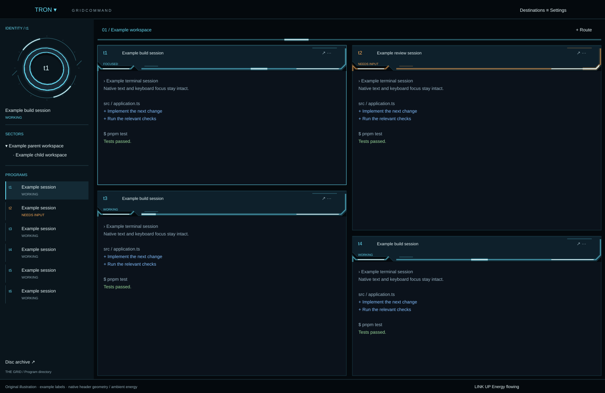

# TRON / Grid Command

A native Herdr layout framed by luminous Legacy-inspired circuitry: a readable workspace with status discs, a game lounge, an interactive solid disc and a real system directory.

## What you see

A 50px title bar reserves 72px for macOS window buttons and carries TRON's native picker, Command, Destinations, sidebar toggle and Settings. A 248px resizable sidebar has a projected identity-disc dock bound to the focused Program, native selectable parent/child SECTORS rows and a scrollable Program list. Parent selection and disclosure are separate actions; no footer hierarchy selector is used. The dock shrinks on short sidebars and hides below 440px available height. A 52px route strip includes a 14px light bus. Pane headers are 68px measured console housings with clipped glass edges, luminous rails, status/address and split/zoom/context controls. Native gaps are 16px; focused and unfocused borders are both 2px, with focus changing color only. A 36px footer includes real counts, local samples, energy preference.

The dark palette uses near-black #04090d, glass #0a151c, cyan #65ddf5 and white-cored #e1fcff illumination. The light palette uses pale #dce8eb/#f3f7f7, dark ink #122c38 and teal #006a80. Both keep #0b121b terminal backgrounds and identical ANSI colors. Geist/Geist Mono are available native fonts; no official logotype is copied. Geometry, palette and motion limits are in design.js and shared with illustrated previews.

## How it behaves

Program labels show Herdr working, blocked, done and idle states. Native opacity loops provide a 4.8-second breathing glow. A light window travels one way (left to right) along each console's seams and the tab bus, about 170 px/s on consoles and 340 px/s on the bus. It holds off-screen for 1.6 s, then re-enters, staggered by pane order in the tab. This is ambient decoration, never a claimed message-delivery event. Reduced motion removes all loops, keeping static light seams and status. Clicking a Program focuses its actual address. Right-click actions retain the row/tab/pane clicked. Creation uses Herdr commands and the built-in new-menu. Herdr retains normal confirmation behavior for closing structural objects.

The pointer picker is content-sized, follows replacement/title/deduplication rules, marks the actual selected layout, and switches through layout.switch. It does not wrap the layout root.

Four dialog destinations provide an attention queue/preferences, local game lounge/archive, interactive 3D disc selector, and system directory. The disc has 192 lit, depth-sorted projected faces with manual yaw and pitch. It has no render timer. Game controls implement all rules in README, victory/loss feedback, restart and persistent per-stage bests. Archive commands are local buttons only. Discovery reset requires confirmation.

## Built from

- `layouts/tron.json`: root column; title, body row (sidebar and work column), footer. Work holds routes and active-tab terminal pane frames. Root owns appearance and terminal-menu selection.
- `mods/tron/main.js`: native View roles top/side/tabs/pane/footer/picker/menu/room/cycle/disc.
- `host.js`: centralized imports from Herdr. No fixture host is installed.
- `games.js`: pure cycle movement, mirror tracing and score reducers.
- `duel.js`: the hidden real-time light-cycle duel: seeded opponent, simultaneous ticks, draws and the local record. The view owns its clock: one `cx.timer.after` per tick, only during a live round, pausing when the arena loses focus, the window is inactive or another layout shows.
- `design.js`: measured console geometry, appearance palettes, disc cradle and bounded native motion parameters. `circuitry.js`: square perspective Grid for the archive.
- `geometry.js`: original XYZ disc mesh, transforms, Lambert lighting and projection.
- `workspace-tree.js` / `workspace-tree-model.js`: native parent/child workspace navigation and machine-scoped shared hierarchy, preserved from the coordinated integration.
- `system.js`: scutil/pmset parsers, layout listing rules and status words.
- `themes/tron-dark.json`, `tron-light.json`: terminal palette plus panel semantic colors.
- `scripts/install.js`: complete staged installer with import/native validation, collision refusal, backups, unowned-file preservation and rollback recovery retention.
- `scripts/check.js`: production imports plus isolated native state fixtures. `scripts/preview.js` writes original SVG illustrations.

Only the footer executes `/usr/sbin/scutil --nwi` and `/usr/bin/pmset -g batt`, at 30-second cadence with an overlap guard, in cx.spawn. The workspace tree also reads local hierarchy/group files and uses read-only `sh -c cat` on configured remote machines. There are no web requests, sound files, DOM APIs or WebGL. The optional shared pane-rename mod is capability-gated, not a dependency: `pane-rename.js` (imports only `herdr`) shows a pane's shared custom name in the console header when one is set, and the pane menu reads `mods/pane-rename/mod.json` once as it opens. Only when that manifest declares `pane_rename_api: 1` does it add **Rename pane…** as the last row, opening the shared dialog for the clicked pane ID. The row arrives after an async check, after the menu has drawn. As the last row it moves nothing already drawn. `pane.close` has no confirmation, so no row may ever be pushed onto it. Without the mod, the menu and headers are unchanged. The installer never installs or updates pane-rename. All progress/preferences use `tron.v1.*`.

## Watch out

Continuous custom routes between arbitrary pane gutters and actual relay-triggered animation require a host extension: no pane bounds, gutter layer or delivery-event feed is currently documented. Do not reconstruct the terminal tree or use an overlay to simulate that capability. The current implementation is confined to headers and the tab bus.

The native checker does not lay out, paint, or click the interface. A fixture pass is not live QA. A sandbox may hang the standalone renderer; a timeout must fail clearly and any permission escalation must use the normal review mechanism. Never start or restart herdr-core as a workaround.

Use the host's exclusive QA lock before live mutation. Stage outside watched mods and publish whole folders, never source files individually. Preserve unrelated settings and restore the previous layout/appearance after testing. Stop immediately if host OOM or repeated Null errors appear.

Native loops only swing there and back (`LoopPolicy.period` is "there and back"), and every loop starts in phase, so no combination of loops can move strictly forward. One-way energy uses `.frames()` instead. Every frames list shares one clock, and a frames text change re-lays out its parent each tick (observed live). The rail art is drawn twice: a lit copy underneath, and an unlit copy split into left and right covers anchored to the edges. The left cover's width is a frames list of transparent JetBrains Mono digits, so the gap between the covers slides forward. All copies must be pixel-identical outside the seams. A `linear_gradient` fill is mapped to each clipped copy separately and showed box edges live, so the plate is a solid fill. Keep game grids bounded (9×7, 7×7 and the 36×22 duel). Narrow dialogs scroll vertically; their boards need roughly 400px of usable width. Non-macOS probes remain unknown. Network-interface availability is not Internet connectivity. No battery state is invented when parsing fails. Physical-state claims must come from observation, not fixtures.

## Done when

- Pure tests prove every game stage can win; walls/trails/limits/misses/restarts/duplicate final actions and score improvement are covered.
- Parser fixtures cover actual/absent/unknown hardware, failures and local network states.
- Installer tests prove import completeness, preserved user files, collision refusal, rollback and retained recovery after rollback failure.
- All native roles pass in dark/light and empty/populated fixtures, including the model, archive, reset and terminal game states.
- Live QA inspects the breathing/travelling motion, reduced-motion fallback, real narrow/wide/ultrawide geometry, uneven splits and supported UI scales, plus idle/active performance.
- Live QA verifies the picker, rooms, game moves and completed wins, disc transforms, source-state indicators, readable terminals in both appearances and final restoration with no errors.
- Documentation explicitly identifies any remaining unverified behavior, and public artifacts contain no private session data.
